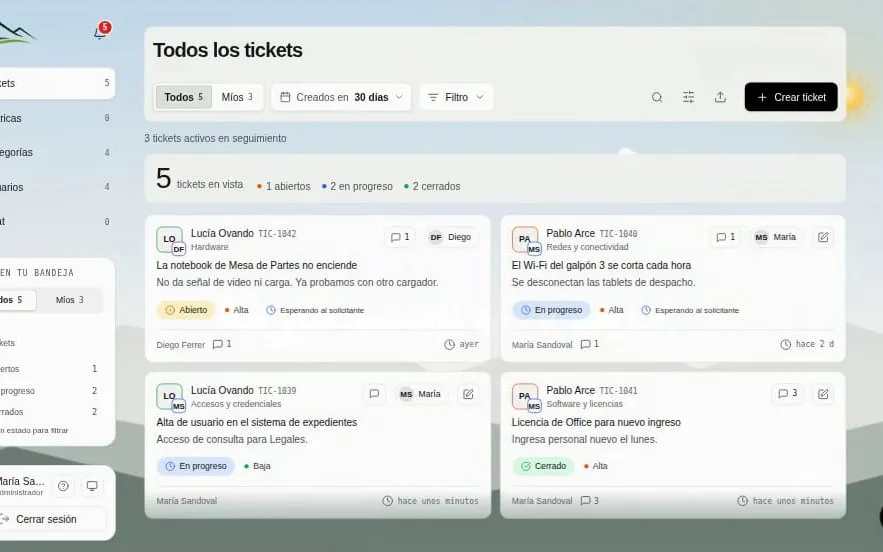
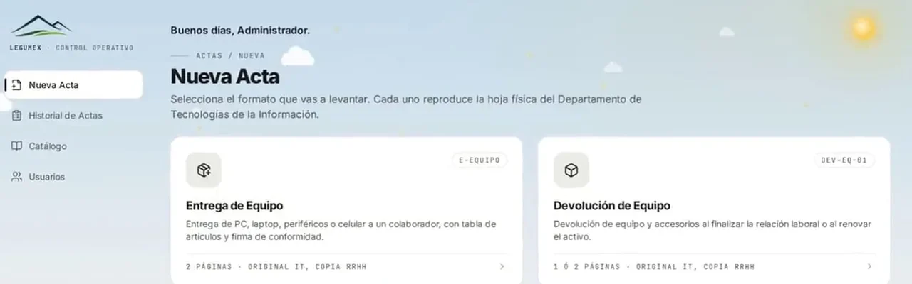
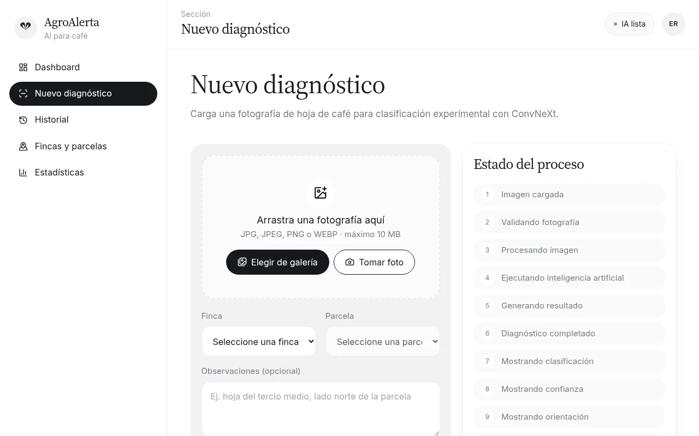
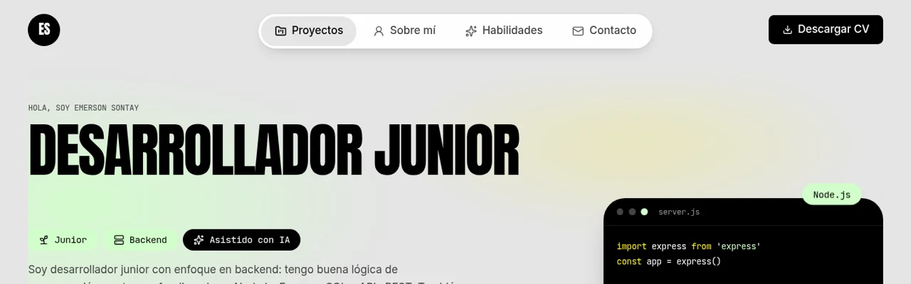

<a href="https://portafolio-c8jc.vercel.app">
  <picture>
    <source media="(prefers-color-scheme: dark)" srcset="assets/hero-dark.svg">
    
  </picture>
</a>

## Sobre mí

- 🧠 **Backend primero.** Tengo buena lógica de programación y estoy profundizando en Node.js, Express, SQL y APIs REST. También he trabajado en frontend con React.
- 🏭 **Experiencia real.** En mi práctica en Agroindustria Legumex participé en dos sistemas internos: Formatos TIC, en uso en el área de TIC, y Tickets TIC.
- 🎓 **Formación.** En 2027 inicio Ingeniería en Sistemas en la Universidad Mariano Gálvez.
- 🤖 **IA como apoyo.** La uso para avanzar y aprender, y reviso y pruebo todo lo que entrego.

## Proyectos destacados

<table>
  <tr>
    <td width="50%" valign="top">
      
      <h3>Sistema de Tickets TIC</h3>
      
Mesa de ayuda interna de Legumex para reportar fallas técnicas y darles seguimiento, con prioridades, chat y métricas. <em>Colaborador, desarrollador en práctica.</em>

      
<code>React</code> <code>Vite</code> <code>API REST</code>

      
      
    </td>
    <td width="50%" valign="top">
      
      <h3>Sistema de Formatos TIC</h3>
      
Gestión de equipos y usuarios, entregas y devoluciones, estado de cada equipo, áreas y marcas, con actas en PDF. En uso en el área de TIC de Legumex. <em>Colaborador, desarrollador en práctica.</em>

      
<code>React</code> <code>Tailwind CSS</code> <code>API Laravel</code>

      
      
    </td>
  </tr>
  <tr>
    <td width="50%" valign="top">
      
      <h3>AgroAlerta AI</h3>
      
MVP del hackathon Build and Pitch 2026: un modelo de IA publicado sobre enfermedades de la hoja de café, llevado a una herramienta para productores. <em>Propuse la idea y la pulí con el equipo.</em>

      
<code>React</code> <code>TypeScript</code> <code>FastAPI</code> <code>PyTorch</code>

      
    </td>
    <td width="50%" valign="top">
      
      <h3>Library-api</h3>
      
API REST de una biblioteca con Express: listar, registrar, actualizar y eliminar libros, con validaciones y códigos de estado HTTP.

      
<code>Node.js</code> <code>Express</code> <code>API REST</code>

      
    </td>
  </tr>
  <tr>
    <td width="50%" valign="top">
      
      <h3>Portafolio</h3>
      
Mi portafolio personal, con el caso completo de cada proyecto: problema, solución, mi rol y tecnologías.

      
<code>Next.js</code> <code>TypeScript</code> <code>Tailwind CSS</code>

      
      
    </td>
    <td width="50%" valign="middle" align="center">
      <h3>¿Hablamos?</h3>
      
Busco oportunidades como desarrollador junior backend.

      
<a href="mailto:emersonrodriguez1455@gmail.com">emersonrodriguez1455@gmail.com</a>

      
      
    </td>
  </tr>
</table>

## Stack

  <picture>
    <source media="(prefers-color-scheme: dark)" srcset="https://skillicons.dev/icons?i=nodejs,express,postgres,mysql,sqlite,react,ts,tailwind,nextjs,git,github,postman,vercel,railway&perline=7&theme=dark">
    
  </picture>

<b>Backend:</b> Node.js · Express · PostgreSQL · MySQL · SQLite · APIs REST <b>Frontend:</b> React · TypeScript · Tailwind CSS · Next.js <b>Herramientas:</b> Git · GitHub · Postman · Vercel · Railway

